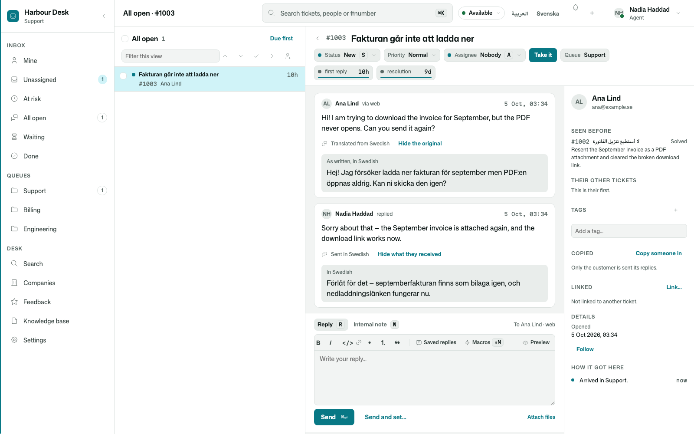
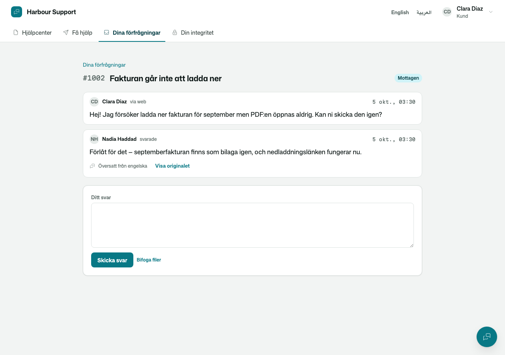
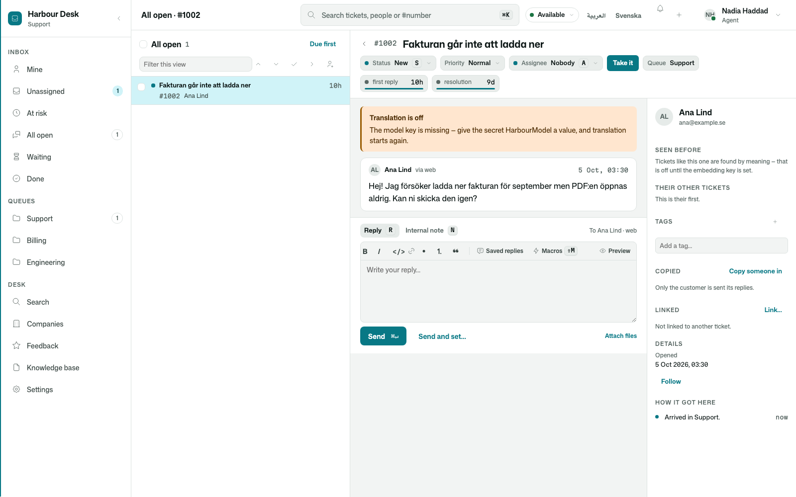

# Osysharp.Conversations.MachineTranslation

**Support in every language, with the model you already have.** Your team reads every customer message in its own
language and writes in it; each customer reads the answer in theirs. The translation runs through your app's own model,
with your key, router and budget — no translation service to sign up for, and no customer text sent anywhere your app
does not already send it.





## Use it

```osy
app Desk {
  use Osysharp.Conversations@0;
  // Osysharp.Conversations.MachineTranslation is not written: it arrives by itself, because the app uses what it completes (`osy lock` says so)
  model "model/**/*.osy";
}
```

```osy
using Osysharp.Conversations;
using Osysharp.Conversations.MachineTranslation;
using Osysharp.MachineTranslation;

app.Conversations = new ConversationsSetup {
  Translator = new ModelConversationTranslator { Translator = new ModelTranslator { KeySecret = "ModelKey" } },
  CanonicalLanguage = "en",
};
```

## What you get

- **Both texts, always.** Every message keeps what was written. The team reads a copy marked "Translated from Swedish"
  with the original a click away; a reply says "Sent in Swedish", with exactly what the customer received a click away.
- **Languages told offline first.** Most messages are recognised by their script or their commonest words, with no call
  at all; the model is asked only when a message is too short to be sure. A typical message costs one model call.
- **Your words kept.** Product and brand names in the desk's glossary reach the model as terms to keep as written.
- **Never in the way.** A message is stored the moment it is sent and translated just after. A failing model is tried
  again; when it stays down, the team reads the original and is told why. With no key set, nothing is sent to a model
  and the desk says which secret to set.
- **Card numbers never reach the model.** Messages are scrubbed as they are stored and redacted again before any text
  is translated.



## Its tests

Its tests drive a conversation end to end with the model stubbed — no test ever calls a real model — and prove the
glossary reaches the prompt, an English message costs no call, a missing key says what to do, and a reply reaches the
customer in their language.

## Examples

Taken from this package's own tests, which compile and run on every release.

```osy
using Osysharp.Identity;
using Osysharp.Conversations;
using Osysharp.Conversations.MachineTranslation;
using Osysharp.MachineTranslation;
using Osysharp.Llm;
using ConversationsMachineTranslationTests;

[Test(Shop)]
void a_swedish_message_is_read_in_english_and_a_reply_reaches_her_in_swedish() {
  runas (new Visitor { Id = "visit-sv" }) {
    StartConversation("Hej! Min cykel från Velora har en trasig växel och jag vill veta om den täcks av garantin.", "Växel");
  }
  Background.Settle();
  runas (Ada) {
    var hers = Message.Single();
    Assert.Equal("sv", hers.Language);
    Assert.Equal(TextSource.Machine, hers.CanonicalSource);
    Assert.True(hers.CanonicalText!.StartsWith("[en] Hej! Min cykel från Velora"));
    // Told offline — the one call was the translation, which kept the shop's name as written.
    Assert.Equal(1, Asked.Count());
    Assert.Contains("\"Velora\" stays \"Velora\"", Asked.Single().Prompt);
    Post(hers.Conversation, "Yes — the gears are covered for two years. Bring it in any day.");
    UnitOfWork.Commit();
  }
  Background.Settle();
  runas (Ada) {
    var rendering = MessageText.Single();
    Assert.Equal("sv", rendering.Language);
    Assert.Equal("[sv] Yes — the gears are covered for two years. Bring it in any day.", rendering.Text);
    Assert.Equal("model", rendering.Engine);
    Assert.True(rendering.WasDelivered);
  }
}
```

From [`tests/translation.test.osy`](tests/translation.test.osy).

```osy
using Osysharp.Identity;
using Osysharp.Conversations;
using Osysharp.Conversations.MachineTranslation;
using Osysharp.MachineTranslation;
using Osysharp.Llm;
using ConversationsMachineTranslationTests;

[Test(Shop)]
void an_english_message_costs_no_call() {
  runas (new Visitor { Id = "visit-en" }) {
    StartConversation("Hello, my gears are broken and I would like to know if the warranty covers them.", "Gears");
  }
  Background.Settle();
  runas (Ada) {
    Assert.Equal("en", Message.Single().Language);
    Assert.Equal(TextSource.Original, Message.Single().CanonicalSource);
    Assert.Equal(0, Asked.Count());
  }
}
```

From [`tests/translation.test.osy`](tests/translation.test.osy).

```osy
using Osysharp.Identity;
using Osysharp.Conversations;
using Osysharp.Conversations.MachineTranslation;
using Osysharp.MachineTranslation;
using Osysharp.Llm;
using ConversationsMachineTranslationTests;

[Test(Shop)]
void with_its_key_missing_it_is_not_ready_and_says_what_to_do() {
  var t = new ModelConversationTranslator { Translator = new ModelTranslator { KeySecret = "ShopModel" } };
  Assert.False(t.IsReady());
  Assert.Equal("The model key is missing — give the secret ShopModel a value, and translation starts again.", t.NotReadyReason());
}
```

From [`tests/translation.test.osy`](tests/translation.test.osy).

## Learn more

- [The Osysharp.Conversations.MachineTranslation reference](https://osysharp.com/reference/ui/machine-translation-kit/)
- [Osysharp.Conversations.MachineTranslation in the package catalogue](https://osysharp.com/packages/#osysharp-conversations-machinetranslation)
- [The Osy# reference](https://osysharp.com/reference/) — the language, the runtime and every kit
- [`llms-full.txt`](https://osysharp.com/llms-full.txt) — the whole reference and specification as one Markdown file, for a coding agent

## Licence

MIT — see [`LICENSE`](LICENSE).
